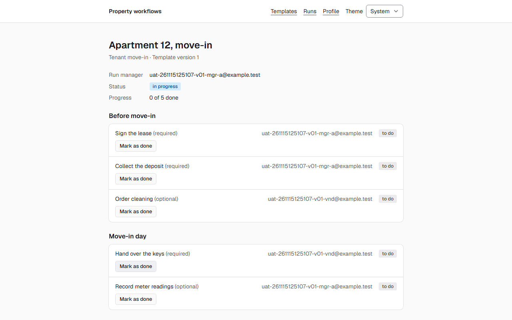
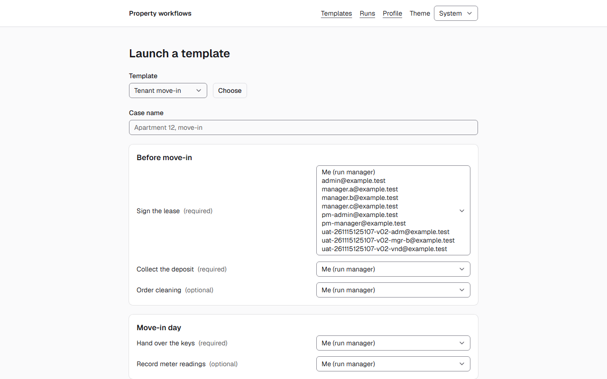
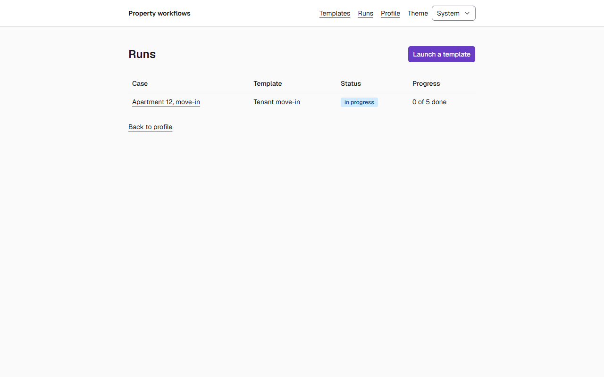

# Звіт UAT — 15.11.2026

- **Застосунок:** https://property-workflows-factory-eight.vercel.app (/api/health: коміт `a5cabbd`)
- **Код тестів:** `HEAD` @ `6c9edf4`
- **Прогін:** 15.11.2026, 14:51 (Київ), Playwright 69.5 с; AC: 3 — PASS 2, FAIL 1, NEEDS-HUMAN 0
- **Рецензент:** `claude-haiku-5-5`; суперечки → `claude-sonnet-5-5`. Разом за розбір: $0.0757 (ціни API; за підпискою — у межах ліміту плану)
- **Прибирання:** синтетичних uat-*@example.test видалено 9, лишилось 0, їхніх рядків, що лишились: 0
- **Відео й траси:** не в git — `test-results/` локально або артефакт CI; трасу відкриває `npx playwright show-trace <trace.zip>`

| AC | Перевірки | Агент | Підсумок | Чому | Playwright | Розбір |
|---|---|---|---|---|---|---|
| AC-VENDOR-01 | пройшли | Haiku: NEEDS-HUMAN, Sonnet: PASS | **PASS** | R6: перевірки, агент і цитати збігаються | 19.2 с | $0.0367, 25.2 с |
| AC-VENDOR-02 | пройшли | Haiku: NEEDS-HUMAN, Sonnet: PASS | **PASS** | R6: перевірки, агент і цитати збігаються | 15.3 с | $0.0365, 25.3 с |
| AC-VENDOR-09 | впали | Haiku: FAIL | **FAIL** | R1: перевірка впала — FAIL завжди, агент не перекриває | 18.3 с | $0.0025, 11.5 с |

## AC-VENDOR-01 — PASS

**Тест:** AC-VENDOR-01: менеджер A запускає «Tenant move-in» для «Apartment 12, move-in» і призначає вендора V на задачі 3 і 4 — вони за V, а задачі 1, 2 і 5 за A

**Критерій** (requirements/39-assign-a-vendor.md):

> AC-VENDOR-01: Given manager A, vendor V and the template "Tenant move-in" with 5 tasks. When A launches the template for the case "Apartment 12, move-in" and assigns V as the assignee of tasks 3 and 4. Then tasks 3 and 4 have V as the assignee, and tasks 1, 2 and 5 have A.



**Кроки:** ✔ Дано: manager A, vendor V and the template "Tenant move-in" with 5 tasks → ✔ Коли: A launches the template for the case "Apartment 12, move-in" and assigns V as the assignee of tasks 3 and 4 → ✔ Тоді: tasks 3 and 4 have V as the assignee, and tasks 1, 2 and 5 have A.

**Агент (claude-sonnet-5-5, PASS):** На кадрі заголовок «Apartment 12, move-in». Задачі Order cleaning і Hand over the keys мають виконавця ...-v01-vnd@example.test (V). Задачі Sign the lease, Collect the deposit і Record meter readings мають ...-v01-mgr-a@example.test (A).

Haiku сказав NEEDS-HUMAN, тож розбір повторив Sonnet; рішення агента — за Sonnet.

**Цитати агента, звірені зі сторінкою (aria):**
- «Apartment 12, move-in» — є на сторінці
- «Order cleaning» — є на сторінці
- «uat-261115125107-v01-vnd@example.test» — є на сторінці
- «Hand over the keys» — є на сторінці
- «uat-261115125107-v01-vnd@example.test» — є на сторінці
- «Sign the lease» — є на сторінці
- «uat-261115125107-v01-mgr-a@example.test» — є на сторінці
- «Collect the deposit» — є на сторінці
- «uat-261115125107-v01-mgr-a@example.test» — є на сторінці
- «Record meter readings» — є на сторінці
- «uat-261115125107-v01-mgr-a@example.test» — є на сторінці

**Правило:** R6: перевірки, агент і цитати збігаються

**Відео:** `test-results/artifacts/vendor-assign-AC-VENDOR-01-f0642--за-V-а-задачі-1-2-і-5-за-A-chromium/video.webm` · **траса:** `test-results/artifacts/vendor-assign-AC-VENDOR-01-f0642--за-V-а-задачі-1-2-і-5-за-A-chromium/trace.zip` (не в git)

**Рішення PM:** ☐ приймаю · ☐ відхилення від вимог (issue «Відхилення від вимог: AC-VENDOR-01 — …») · @login: ____

## AC-VENDOR-02 — PASS

**Тест:** AC-VENDOR-02: у виборі виконавця менеджер A бачить email менеджера B, адміністратора й вендора V — і жодних імен, ролей чи інших даних профілю

**Критерій** (requirements/39-assign-a-vendor.md):

> AC-VENDOR-02: Given managers A and B, an administrator and vendor V, and A launching a template. When A opens the assignee picker. Then A sees the emails of B, of the administrator and of V, and no names, roles or other profile data.



**Кроки:** ✔ Дано: managers A and B, an administrator and vendor V, and A launching a template → ✔ Коли: A opens the assignee picker → ✔ Тоді: A sees the emails of B, of the administrator and of V, and no names, roles or other profile data.

**Агент (claude-sonnet-5-5, PASS):** На кадрі /runs/new відкрито список виконавця для задачі «Sign the lease». У ньому є «Me (run manager)» та лише email-адреси, серед яких uat-…-mgr-b, uat-…-adm і uat-…-vnd. Імен і ролей у списку не видно. Що саме ці три адреси належать B, адміну й V, видно лише з їхніх суфіксів.

Haiku сказав NEEDS-HUMAN, тож розбір повторив Sonnet; рішення агента — за Sonnet.

**Цитати агента, звірені зі сторінкою (aria):**
- «uat-261115125107-v02-mgr-b@example.test» — є на сторінці
- «uat-261115125107-v02-adm@example.test» — є на сторінці
- «uat-261115125107-v02-vnd@example.test» — є на сторінці

**Правило:** R6: перевірки, агент і цитати збігаються

**Відео:** `test-results/artifacts/vendor-assign-AC-VENDOR-02-6a9c2-олей-чи-інших-даних-профілю-chromium/video.webm` · **траса:** `test-results/artifacts/vendor-assign-AC-VENDOR-02-6a9c2-олей-чи-інших-даних-профілю-chromium/trace.zip` (не в git)

**Рішення PM:** ☐ приймаю · ☐ відхилення від вимог (issue «Відхилення від вимог: AC-VENDOR-02 — …») · @login: ____

## AC-VENDOR-09 — FAIL

**Тест:** AC-VENDOR-09: вендор V прямим запитом, в обхід сторінок, запускає «Tenant move-in» — запуск не створено, список запусків не змінився

**Критерій** (requirements/39-assign-a-vendor.md):

> AC-VENDOR-09: Given vendor V signed in and the template "Tenant move-in" with current version 1. When V tries to launch this template directly, bypassing the pages of the application. Then no run is created, and the list of runs does not change.



**Кроки:** ✔ Дано: vendor V signed in and the template "uat-261115125107-v09-tpl" (the tasks of "Tenant move-in") with current version 1 → ✔ Коли: V tries to launch this template directly, bypassing the pages of the application → ✘ Тоді: no run is created, and the list of runs does not change.

**Перевірка впала:**

```
Error: expect(locator).toHaveText(expected) failed

Locator: getByTestId('run-row').first().getByTestId('your-tasks')
Expected: "Your tasks: 0 of 2 done"
Timeout: 5000ms
Error: element(s) not found

Call log:
```

**Агент (claude-haiku-5-5, FAIL):** На кадрі /runs видно один рядок «Apartment 12, move-in» (шаблон «Tenant move-in», статус «in progress», прогрес «0 of 5 done»). Рядка «Apartment 16, move-in» немає, тож частина про відсутність спроби виконується. Проте текст «Your tasks: 0 of 2 done» на кадрі відсутній, тому перша частина «Тоді» не відповідає критерію; також кадр не показує, чий це список (V чи інший користувач).

**Агент бачить вади:**
- У списку запусків на кадрі єдиний рядок «Apartment 12, move-in», але в колонці Progress написано «0 of 5 done», а не очікуване в критерії «Your tasks: 0 of 2 done». Текст прогресу не збігається з критерієм ні за формулюванням, ні за числом задач.
- На кадрі немає жодного напису «Your tasks», тож частина «Тоді» про рядок зі «Your tasks: 0 of 2 done» не підтверджена кадром.

**Цитати агента, звірені зі сторінкою (aria):**
- «Apartment 12, move-in» — є на сторінці

**Правило:** R1: перевірка впала — FAIL завжди, агент не перекриває

**Відео:** `test-results/artifacts/vendor-forbidden-AC-VENDOR-01f35-список-запусків-не-змінився-chromium/video.webm` · **траса:** `test-results/artifacts/vendor-forbidden-AC-VENDOR-01f35-список-запусків-не-змінився-chromium/trace.zip` (не в git)

**Рішення PM:** ☐ приймаю · ☐ відхилення від вимог (issue «Відхилення від вимог: AC-VENDOR-09 — …») · @login: ____

## Як читати підсумок

- **PASS** — автоматичні перевірки пройшли, агент-рецензент погодився з кадром, а кожну його цитату знайдено на сторінці.
- **FAIL** — впала автоматична перевірка. Агент цього не перекриває: невидимі вади (буфер обміну, база) він на кадрі не побачить.
- **NEEDS-HUMAN** — перевірки зелені, але агент не погодився або його цитати немає на сторінці. Часто це слабкий тест або розбіжність між текстом AC і тестом — питання до PM, а не обов'язково вада продукту.

Правила: R1: перевірка впала — FAIL завжди, агент не перекриває; R2: немає вердикту агента або кадру; R3: перевірки пройшли, агент не погоджується — вирішує людина; R4: цитати агента немає на сторінці (aria) — не підтверджено; R5: помилка сторінки або 5xx під час сценарію; R6: перевірки, агент і цитати збігаються.
