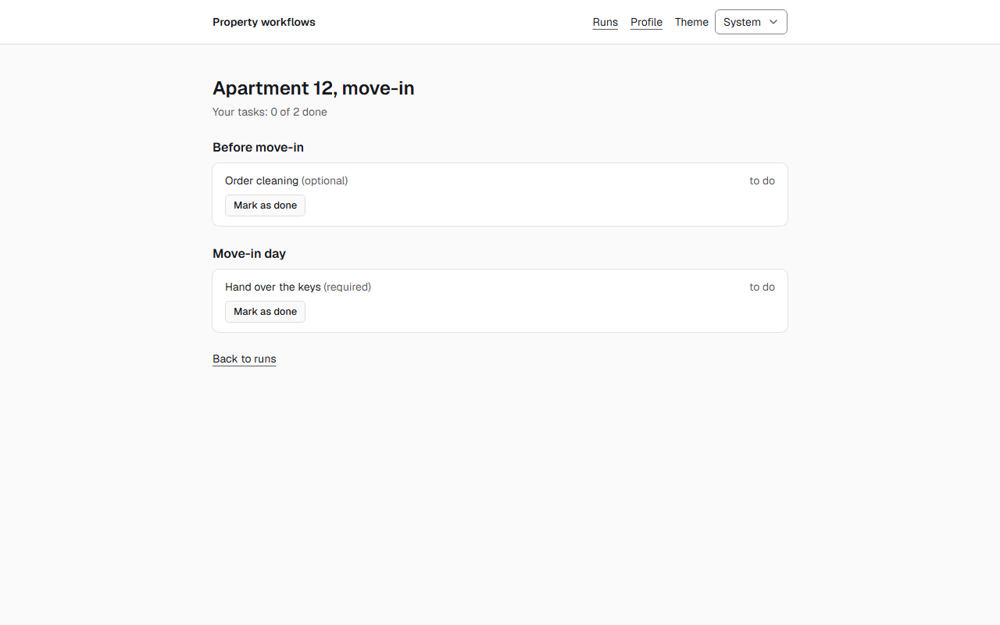
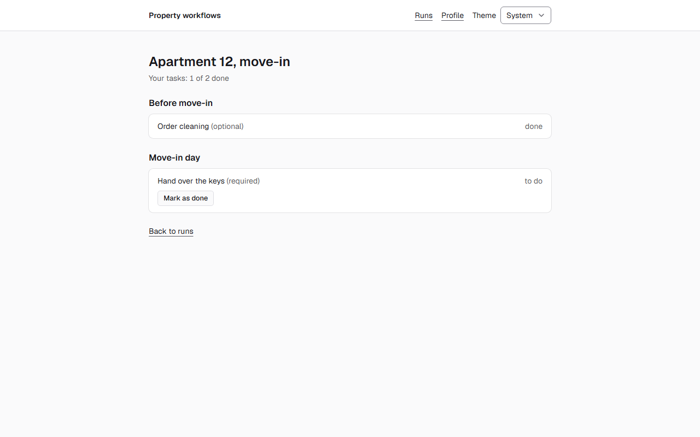
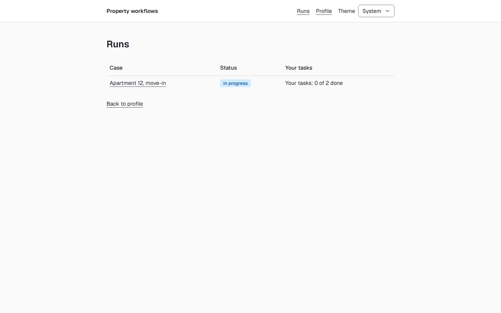
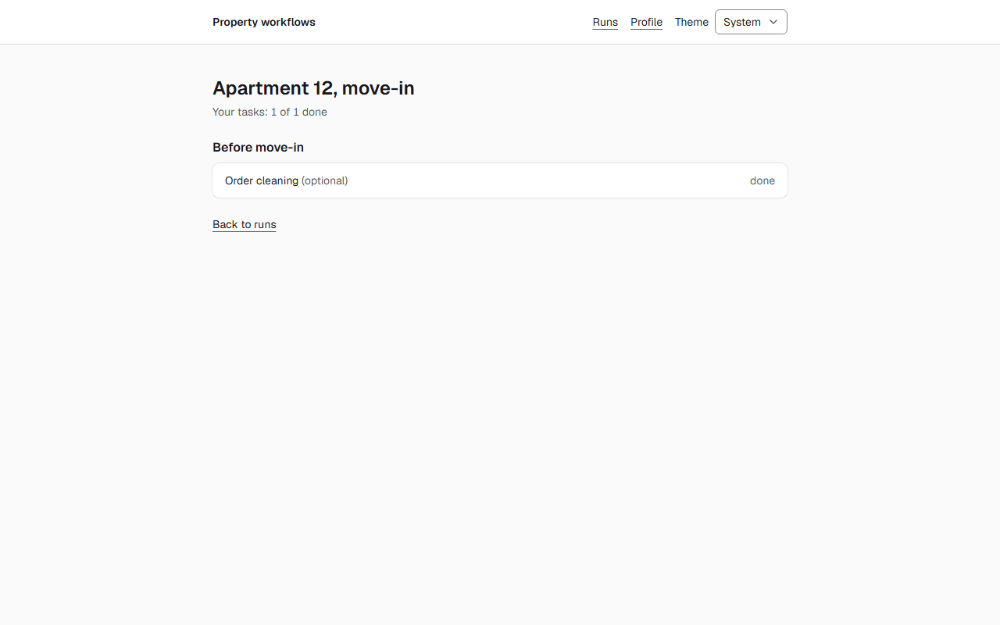
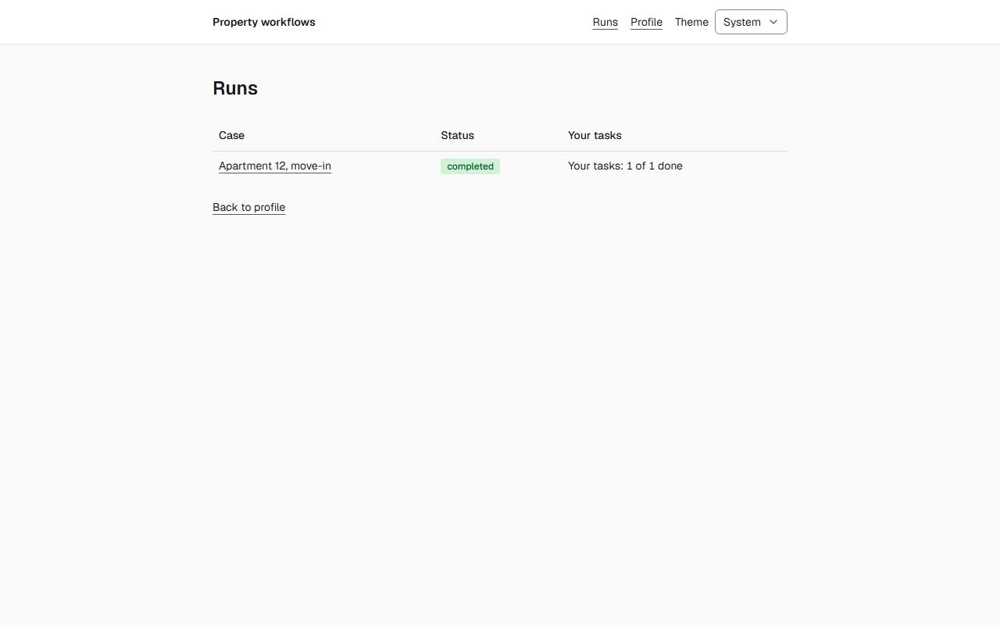

# Звіт UAT — 16.11.2026

- **Застосунок:** https://property-workflows-factory-eight.vercel.app (/api/health: коміт `cd5b90d`)
- **Код тестів:** `HEAD` @ `060e0be` + незакомічені зміни
- **Прогін:** 16.11.2026, 10:16 (Київ), Playwright 128.0 с; AC: 7 — PASS 6, FAIL 1, NEEDS-HUMAN 0
- **Рецензент:** `claude-haiku-5-5`; суперечки → `claude-sonnet-5-5`. Разом за розбір: $0.0164 (ціни API; за підпискою — у межах ліміту плану)
- **Прибирання:** синтетичних uat-*@example.test видалено 15, лишилось 0, їхніх рядків, що лишились: 0
- **Відео й траси:** не в git — `test-results/` локально або артефакт CI; трасу відкриває `npx playwright show-trace <trace.zip>`

| AC | Перевірки | Агент | Підсумок | Чому | Playwright | Розбір |
|---|---|---|---|---|---|---|
| AC-VENDOR-03 | пройшли | Haiku: PASS | **PASS** | R6: перевірки, агент і цитати збігаються | 13.1 с | $0.0022, 7.8 с |
| AC-VENDOR-04 | пройшли | Haiku: PASS | **PASS** | R6: перевірки, агент і цитати збігаються | 15.6 с | $0.0028, 10.9 с |
| AC-VENDOR-05 | пройшли | Haiku: PASS | **PASS** | R6: перевірки, агент і цитати збігаються | 15.7 с | $0.0021, 8.1 с |
| AC-VENDOR-09 | пройшли | Haiku: PASS | **PASS** | R6: перевірки, агент і цитати збігаються | 15.7 с | $0.0023, 9.2 с |
| AC-VENDOR-11 | пройшли | Haiku: PASS | **PASS** | R6: перевірки, агент і цитати збігаються | 13.7 с | $0.0024, 8.5 с |
| AC-VENDOR-12 | впали | Haiku: PASS | **FAIL** | R1: перевірка впала — FAIL завжди, агент не перекриває | 19.9 с | $0.0020, 6.2 с |
| AC-VENDOR-16 | пройшли | Haiku: PASS | **PASS** | R6: перевірки, агент і цитати збігаються | 18.5 с | $0.0026, 8.3 с |

## AC-VENDOR-03 — PASS

**Тест:** AC-VENDOR-03: вендор V із двома задачами в «Apartment 12, move-in» і без задач в «Apartment 14, repair» бачить у списку лише перший запуск, його статус і «Your tasks: 0 of 2 done»

**Критерій** (requirements/39-assign-a-vendor.md):

> AC-VENDOR-03: Given vendor V who is the assignee of 2 tasks in the run "Apartment 12, move-in" and of no task in the run "Apartment 14, repair". When V opens the list of runs. Then V sees only the run "Apartment 12, move-in" with its run status and "Your tasks: 0 of 2 done", and does not see "Apartment 14, repair".


**Кроки:** ✔ Дано: vendor V who is the assignee of 2 tasks in the run "Apartment 12, move-in" and of no task in the run "Apartment 14, repair" → ✔ Коли: V opens the list of runs → ✔ Тоді: V sees only the run "Apartment 12, move-in" with its run status and "Your tasks: 0 of 2 done", and does not see "Apartment 14, repair".

**Агент (claude-haiku-5-5, PASS):** На кадрі сторінки «Runs» є рівно один рядок: «Apartment 12, move-in» зі статусом «in progress» і написом «Your tasks: 0 of 2 done». Запис «Apartment 14, repair» на кадрі не видно, але це частина з розділу «Не з кадрів», тож її не оцінюю.

**Цитати агента, звірені зі сторінкою (aria):**
- «Apartment 12, move-in» — є на сторінці
- «in progress» — є на сторінці
- «Your tasks: 0 of 2 done» — є на сторінці

**Правило:** R6: перевірки, агент і цитати збігаються

**Відео:** `test-results/artifacts/vendor-runs-AC-VENDOR-03-в-597b4--і-«Your-tasks-0-of-2-done»-chromium/video.webm` · **траса:** `test-results/artifacts/vendor-runs-AC-VENDOR-03-в-597b4--і-«Your-tasks-0-of-2-done»-chromium/trace.zip` (не в git)

**Рішення PM:** ☐ приймаю · ☐ відхилення від вимог (issue «Відхилення від вимог: AC-VENDOR-03 — …») · @login: ____

## AC-VENDOR-04 — PASS

**Тест:** AC-VENDOR-04: вендор V відкриває «Apartment 12, move-in» (5 задач) і бачить рівно задачі 3 і 4 — назва, розділ, «required» чи «optional» і статус, без чужих задач, email інших користувачів і прогресу всього запуску

**Критерій** (requirements/39-assign-a-vendor.md):

> AC-VENDOR-04: Given vendor V who is the assignee of tasks 3 and 4 in the run "Apartment 12, move-in" (5 tasks). When V opens this run. Then V sees exactly tasks 3 and 4, each with its name, its section, the mark "required" or "optional" and its status, and does not see tasks 1, 2 and 5, the emails of other users or the progress of the whole run.



**Кроки:** ✔ Дано: vendor V who is the assignee of tasks 3 and 4 in the run "Apartment 12, move-in" (5 tasks) → ✔ Коли: V opens this run → ✔ Тоді: V sees exactly tasks 3 and 4, each with its name, its section, the mark "required" or "optional" and its status, and does not see tasks 1, 2 and 5, the emails of other users or the progress of the whole run.

**Агент (claude-haiku-5-5, PASS):** На кадрі видно сторінку «Apartment 12, move-in» з двома задачами: «Order cleaning (optional)» у розділі «Before move-in» і «Hand over the keys (required)» у розділі «Move-in day», обидві зі статусом «to do». Заголовок «Your tasks: 0 of 2 done» стосується лише задач користувача, а не прогресу всього запуску. Частини про відсутність задач 1, 2, 5, чужих email і прогресу запуску не з кадрів, тому тут не оцінювалися.

**Цитати агента, звірені зі сторінкою (aria):**
- «Your tasks: 0 of 2 done» — є на сторінці
- «Order cleaning (optional)» — є на сторінці
- «Hand over the keys (required)» — є на сторінці
- «Before move-in» — є на сторінці
- «Order cleaning (optional)» — є на сторінці
- «Order cleaning (optional)» — є на сторінці
- «to do» — є на сторінці
- «Move-in day» — є на сторінці
- «Hand over the keys (required)» — є на сторінці
- «Hand over the keys (required)» — є на сторінці
- «to do» — є на сторінці

**Правило:** R6: перевірки, агент і цитати збігаються

**Відео:** `test-results/artifacts/vendor-runs-AC-VENDOR-04-в-9b0aa-в-і-прогресу-всього-запуску-chromium/video.webm` · **траса:** `test-results/artifacts/vendor-runs-AC-VENDOR-04-в-9b0aa-в-і-прогресу-всього-запуску-chromium/trace.zip` (не в git)

**Рішення PM:** ☐ приймаю · ☐ відхилення від вимог (issue «Відхилення від вимог: AC-VENDOR-04 — …») · @login: ____

## AC-VENDOR-05 — PASS

**Тест:** AC-VENDOR-05: вендор V позначає виконаною свою задачу 3 (не остання обов'язкова) — вона «done», а V бачить «Your tasks: 1 of 2 done»

**Критерій** (requirements/39-assign-a-vendor.md):

> AC-VENDOR-05: Given vendor V who is the assignee of task 3 with status "to do", which is not the last required task of the run "Apartment 12, move-in". When V marks task 3 as done. Then task 3 has status "done", and V sees "Your tasks: 1 of 2 done".



**Кроки:** ✔ Дано: vendor V who is the assignee of task 3 with status "to do", which is not the last required task of the run "Apartment 12, move-in" → ✔ Коли: V marks task 3 as done → ✔ Тоді: task 3 has status "done", and V sees "Your tasks: 1 of 2 done".

**Агент (claude-haiku-5-5, PASS):** На кадрі в картці «Before move-in» видно «Order cleaning (optional)» зі статусом «done», а під заголовком сторінки — «Your tasks: 1 of 2 done», що збігається з критерієм посимвольно. Номер задачі 3 на екрані не показано, тож ідентифікація спирається на назву «Order cleaning», яку називає ac.md; це не впливає на вердикт.

**Цитати агента, звірені зі сторінкою (aria):**
- «Order cleaning (optional)» — є на сторінці
- «done» — є на сторінці
- «Your tasks: 1 of 2 done» — є на сторінці

**Правило:** R6: перевірки, агент і цитати збігаються

**Відео:** `test-results/artifacts/vendor-runs-AC-VENDOR-05-в-e392a-ть-«Your-tasks-1-of-2-done»-chromium/video.webm` · **траса:** `test-results/artifacts/vendor-runs-AC-VENDOR-05-в-e392a-ть-«Your-tasks-1-of-2-done»-chromium/trace.zip` (не в git)

**Рішення PM:** ☐ приймаю · ☐ відхилення від вимог (issue «Відхилення від вимог: AC-VENDOR-05 — …») · @login: ____

## AC-VENDOR-09 — PASS

**Тест:** AC-VENDOR-09: вендор V прямим запитом, в обхід сторінок, запускає «Tenant move-in» — запуск не створено, список запусків не змінився

**Критерій** (requirements/39-assign-a-vendor.md):

> AC-VENDOR-09: Given vendor V signed in and the template "Tenant move-in" with current version 1. When V tries to launch this template directly, bypassing the pages of the application. Then no run is created, and the list of runs does not change.


**Кроки:** ✔ Дано: vendor V signed in and the template "uat-261116081653-v09-tpl" (the tasks of "Tenant move-in") with current version 1 → ✔ Коли: V tries to launch this template directly, bypassing the pages of the application → ✔ Тоді: no run is created, and the list of runs does not change.

**Агент (claude-haiku-5-5, PASS):** На кадрі /runs видно лише один рядок: «Apartment 12, move-in», статус «in progress», «Your tasks: 0 of 2 done». Рядка «Apartment 16, move-in» немає. Кадр один, тож стан списку до спроби не видно: твердження «той самий» спирається на очікуваний вихідний стан, а не на порівняння з кадром «до».

**Цитати агента, звірені зі сторінкою (aria):**
- «Apartment 12, move-in» — є на сторінці
- «Your tasks: 0 of 2 done» — є на сторінці
- «Apartment 12, move-in» — є на сторінці

**Правило:** R6: перевірки, агент і цитати збігаються

**Відео:** `test-results/artifacts/vendor-forbidden-AC-VENDOR-01f35-список-запусків-не-змінився-chromium/video.webm` · **траса:** `test-results/artifacts/vendor-forbidden-AC-VENDOR-01f35-список-запусків-не-змінився-chromium/trace.zip` (не в git)

**Рішення PM:** ☐ приймаю · ☐ відхилення від вимог (issue «Відхилення від вимог: AC-VENDOR-09 — …») · @login: ____

## AC-VENDOR-11 — PASS

**Тест:** AC-VENDOR-11: вендор V із задачами 3 («done») і 4 («to do») відкриває «Apartment 12, move-in» — заголовок сторінки — назва випадку, «Your tasks: 1 of 2 done», без статусу запуску, назви й версії шаблону

**Критерій** (requirements/39-assign-a-vendor.md):

> AC-VENDOR-11: Given vendor V who is the assignee of tasks 3 ("done") and 4 ("to do") in the run "Apartment 12, move-in" (5 tasks). When V opens this run. Then V sees the case name "Apartment 12, move-in" as the title of the page and "Your tasks: 1 of 2 done", and does not see the run status, the template name or the template version.


**Кроки:** ✔ Дано: vendor V who is the assignee of tasks 3 ("done") and 4 ("to do") in the run "Apartment 12, move-in" (5 tasks) → ✔ Коли: V opens this run → ✔ Тоді: V sees the case name "Apartment 12, move-in" as the title of the page and "Your tasks: 1 of 2 done", and does not see the run status, the template name or the template version.

**Агент (claude-haiku-5-5, PASS):** На кадрі frame-then-1.png видно заголовок «Apartment 12, move-in» і рядок «Your tasks: 1 of 2 done» під ним — обидва точно збігаються з критерієм. Статус запуску, назву шаблону та його версію на кадрі не видно, але за розділом «Не з кадрів» їх перевіряють автоматичні перевірки, тому я їх не оцінюю.

**Цитати агента, звірені зі сторінкою (aria):**
- «Apartment 12, move-in» — є на сторінці
- «Your tasks: 1 of 2 done» — є на сторінці

**Правило:** R6: перевірки, агент і цитати збігаються

**Відео:** `test-results/artifacts/vendor-runs-AC-VENDOR-11-в-96627-уску-назви-й-версії-шаблону-chromium/video.webm` · **траса:** `test-results/artifacts/vendor-runs-AC-VENDOR-11-в-96627-уску-назви-й-версії-шаблону-chromium/trace.zip` (не в git)

**Рішення PM:** ☐ приймаю · ☐ відхилення від вимог (issue «Відхилення від вимог: AC-VENDOR-11 — …») · @login: ____

## AC-VENDOR-12 — FAIL

**Тест:** AC-VENDOR-12: вендор V відкриває список запусків — рядок «Apartment 12, move-in» показує назву випадку, статус запуску й «Your tasks: 0 of 2 done», без назви шаблону «Tenant move-in»

**Критерій** (requirements/39-assign-a-vendor.md):

> AC-VENDOR-12: Given vendor V who is the assignee of 2 tasks in the run "Apartment 12, move-in", launched from the template "Tenant move-in". When V opens the list of runs. Then the row of this run shows the case name, the run status and "Your tasks: 0 of 2 done", and does not show the template name "Tenant move-in".



**Кроки:** ✔ Дано: vendor V who is the assignee of 2 tasks in the run "Apartment 12, move-in", launched from the template "Tenant move-in" → ✔ Коли: V opens the list of runs → ✔ Тоді: the row of this run shows the case name, the run status and "Your tasks: 0 of 2 done", and does not show the template name "Tenant move-in".

**Перевірка впала:**

```
Error: expect(page).toHaveURL(expected) failed

Expected pattern: /\/runs\/52b40d52-6f49-4887-9fe1-f4bd69cf54ee$/
Received string:  "https://property-workflows-factory-eight.vercel.app/runs"
Timeout: 5000ms

Call log:
  - taking page screenshot
```

**Агент (claude-haiku-5-5, PASS):** На кадрі /runs видно один рядок із назвою «Apartment 12, move-in», статусом «in progress» і текстом «Your tasks: 0 of 2 done» у колонці «Your tasks». Кадр чіткий, не обрізаний; назви шаблону «Tenant move-in» на кадрі немає, але це перевіряють автоматично, тому я це не оцінюю.

**Цитати агента, звірені зі сторінкою (aria):**
- «Apartment 12, move-in» — є на сторінці
- «in progress» — є на сторінці
- «Your tasks: 0 of 2 done» — є на сторінці

**Правило:** R1: перевірка впала — FAIL завжди, агент не перекриває

**Відео:** `test-results/artifacts/vendor-runs-AC-VENDOR-12-в-7c4c2-ви-шаблону-«Tenant-move-in»-chromium/video.webm` · **траса:** `test-results/artifacts/vendor-runs-AC-VENDOR-12-в-7c4c2-ви-шаблону-«Tenant-move-in»-chromium/trace.zip` (не в git)

**Рішення PM:** ☐ приймаю · ☐ відхилення від вимог (issue «Відхилення від вимог: AC-VENDOR-12 — …») · @login: ____

## AC-VENDOR-16 — PASS

**Тест:** AC-VENDOR-16: вендор V позначає свою необов'язкову задачу 3 у «Apartment 12, move-in» зі статусом «completed» — «done», «Your tasks: 1 of 1 done», запуск лишається «completed»

**Критерій** (requirements/39-assign-a-vendor.md):

> AC-VENDOR-16: Given the run "Apartment 12, move-in" with status "completed" in which vendor V is the assignee of the optional task 3 with status "to do". When V marks task 3 as done. Then task 3 has status "done", V sees "Your tasks: 1 of 1 done", and the run stays "completed".




**Кроки:** ✔ Дано: the run "Apartment 12, move-in" with status "completed" in which vendor V is the assignee of the optional task 3 with status "to do" → ✔ Коли: V marks task 3 as done → ✔ Тоді: task 3 has status "done", V sees "Your tasks: 1 of 1 done", → ✔ Коли: V opens the list of runs → ✔ Тоді: and the run stays "completed".

**Агент (claude-haiku-5-5, PASS):** На frame-then-1 видно сторінку запуску «Apartment 12, move-in» з рядком «Order cleaning (optional)» і статусом «done», а також «Your tasks: 1 of 1 done». На frame-then-2 у списку запусків є рядок «Apartment 12, move-in» зі статусом «completed» і текстом «Your tasks: 1 of 1 done». Усі чотири видимі частини «Тоді» підтверджені дослівними написами на кадрах; кадри чисті, без обрізання й завантаження.

**Цитати агента, звірені зі сторінкою (aria):**
- «Order cleaning (optional)» — є на сторінці
- «done» — є на сторінці
- «Your tasks: 1 of 1 done» — є на сторінці
- «Apartment 12, move-in» — є на сторінці
- «completed» — є на сторінці
- «Your tasks: 1 of 1 done» — є на сторінці

**Правило:** R6: перевірки, агент і цитати збігаються

**Відео:** `test-results/artifacts/optional-after-completed-A-e6c2b-апуск-лишається-«completed»-chromium/video.webm` · **траса:** `test-results/artifacts/optional-after-completed-A-e6c2b-апуск-лишається-«completed»-chromium/trace.zip` (не в git)

**Рішення PM:** ☐ приймаю · ☐ відхилення від вимог (issue «Відхилення від вимог: AC-VENDOR-16 — …») · @login: ____

## Як читати підсумок

- **PASS** — автоматичні перевірки пройшли, агент-рецензент погодився з кадром, а кожну його цитату знайдено на сторінці.
- **FAIL** — впала автоматична перевірка. Агент цього не перекриває: невидимі вади (буфер обміну, база) він на кадрі не побачить.
- **NEEDS-HUMAN** — перевірки зелені, але агент не погодився або його цитати немає на сторінці. Часто це слабкий тест або розбіжність між текстом AC і тестом — питання до PM, а не обов'язково вада продукту.

Правила: R1: перевірка впала — FAIL завжди, агент не перекриває; R2: немає вердикту агента або кадру; R3: перевірки пройшли, агент не погоджується — вирішує людина; R4: цитати агента немає на сторінці (aria) — не підтверджено; R5: помилка сторінки або 5xx під час сценарію; R6: перевірки, агент і цитати збігаються.
